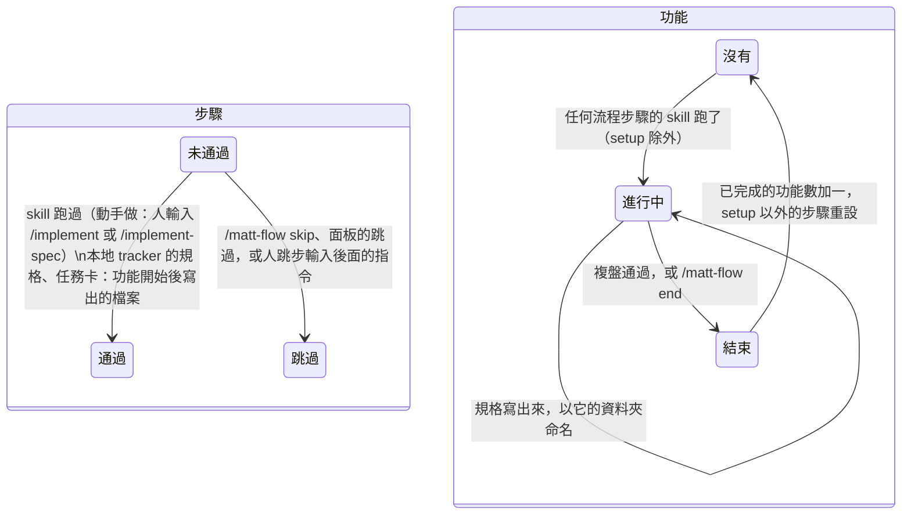

# 02: 功能的生命週期與通過規則

**What to build:** 功能會自己開始、自己結束；每個步驟依照規格裡的規則判斷通過，有產出物的看產出物，沒有的看 skill 有沒有跑過。步驟通過時跳出提示，並預填下一步的指令。從面板和狀態列都看得到效果。

**Blocked by:** 01

**Status:** ready-for-agent

- [x] 沒有進行中的功能時，任何流程步驟的 skill（setup 除外）一跑，就開始一個功能
- [x] 動手做只在人輸入 `/implement` 或 `/implement-spec` 時通過；模型自己執行 `tdd` 不會讓它通過
- [x] 本地 markdown tracker：功能資料夾裡有規格檔，「寫成規格書」才通過；至少有一個任務卡檔案，「切成任務卡」才通過；只輸入 `/to-spec` 不算通過
- [x] GitHub 或 GitLab tracker：這兩個步驟在 skill 跑過時通過
- [x] tracker 的種類從 tracker 設定檔的標題判斷
- [x] 產出物在每一輪結束時檢查；規格產生後，功能以規格所在的資料夾名稱稱呼
- [x] 步驟通過時跳出提示，並在這一輪結束時預填下一步的指令
- [x] 複盤通過時功能結束：已完成的功能數加一，setup 以外的步驟全部重設
- [x] 證據：完成時在本檔底下加「## 證據」，貼上新增測試先失敗、後通過的輸出，以及一張 mermaid 狀態圖（步驟：未通過 → 通過 / 跳過；功能：沒有 → 進行中 → 結束）

## 證據

新增測試先對 01 的模組跑。`on the GitHub tracker…` 和 `a project set up this turn…` 在舊規則下結果剛好一樣，所以一開始就通過；其他五個失敗：

```
(pass) a set-up project starts the beginner at grilling, on every surface
(pass) progress saved by 0.2 carries over: its steps passed, its rounds finished features
(pass) a skill run moves the guide on, and the button types the next command
(pass) a skill the model runs through the Skill tool moves the guide on too
(pass) the expert track builds in parallel
(fail) a flow skill starts a feature, and the retro ends it: it counts, and the next starts from grilling
  Expected: "還沒有進行中的功能"
  Received: undefined
(fail) a passed step hands over: a toast now, the next command suggested when the turn ends
  Expected: ["✔ 把想法問清楚 通過 → 下一步 /implement"]
  Received: ["✔ 把想法問清楚 完成 → 下一步 /implement"]
(fail) only the person typing /implement passes building: the model running tdd or implement does not
  Expected: "▶ 3. 動手做"
  Received: "▶ 4. 檢查"
(fail) on the local tracker, spec and tickets pass on their files, written since the feature started
  Expected: "▶ 3. 寫成規格書"
  Received: "▶ 4. 切成任務卡"
(pass) on the GitHub tracker, spec and tickets pass when their skills run
(pass) a project set up this turn hands over to grilling
(fail) a project never set up stays quiet: skills there start nothing
  Expected: []
  Received: ["✔ 把想法問清楚 完成 → 下一步 /setup-matt-pocock-skills"]
(pass) an em-dash is denied inside the skills repo only
 8 pass
 5 fail
```

改完之後：

```
(pass) a set-up project starts the beginner at grilling, on every surface
(pass) progress saved by 0.2 carries over: its steps passed, its rounds finished features
(pass) a skill run moves the guide on, and the button types the next command
(pass) a skill the model runs through the Skill tool moves the guide on too
(pass) the expert track builds in parallel
(pass) a flow skill starts a feature, and the retro ends it: it counts, and the next starts from grilling
(pass) a passed step hands over: a toast now, the next command suggested when the turn ends
(pass) only the person typing /implement passes building: the model running tdd or implement does not
(pass) on the local tracker, spec and tickets pass on their files, written since the feature started
(pass) on the GitHub tracker, spec and tickets pass when their skills run
(pass) a project set up this turn hands over to grilling
(pass) a project never set up stays quiet: skills there start nothing
(pass) an em-dash is denied inside the skills repo only
 13 pass
 0 fail
```

狀態圖：


