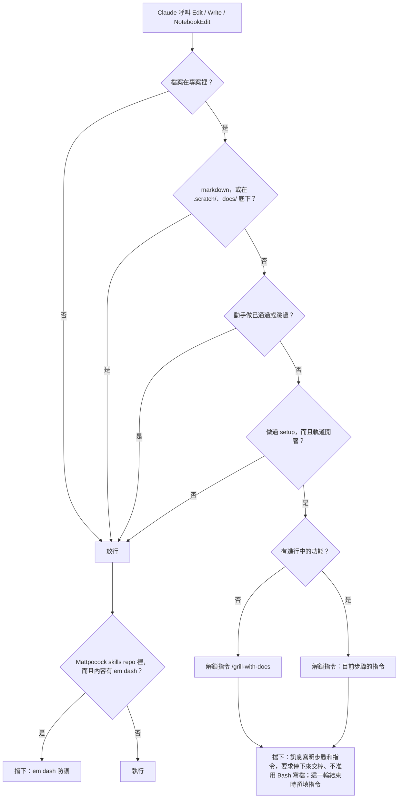

# 03: 程式碼關卡

**What to build:** 還沒動手做之前，Claude 想改程式碼會被擋下。擋下訊息告訴 Claude 要停下來交棒，並寫明解鎖要用的指令；同一個指令會預填給人，按 Enter 就能繼續。

**Blocked by:** 02

**Status:** ready-for-agent

- [x] 專案做過 setup、軌道開著，而且進行中的功能還沒動手做時，Claude 對程式碼的 Edit、Write、NotebookEdit 會被擋下
- [x] 沒有進行中的功能時，擋下訊息指名 `/grill-with-docs`；有功能時，指名通往動手做的路上，下一個還沒通過的步驟的指令
- [x] 擋下訊息要求 Claude 停下來交棒，並且不准改用 Bash 寫檔
- [x] 擋下時，訊息裡的解鎖指令同時預填進人的輸入框
- [x] markdown 檔、暫存資料夾、docs 資料夾，以及專案外的檔案，一律不擋
- [x] 人輸入 `/implement` 之後放行
- [x] 沒做過 setup 的專案完全不擋
- [x] Matt skills repo 裡的 em dash 防護照舊
- [x] 證據：完成時在本檔底下加「## 證據」，貼上新增測試先失敗、後通過的輸出，以及一張 mermaid 流程圖（一個 Edit 從進來到放行或擋下）
- [x] 證據截圖（由人截）：在一個做過 setup、沒有進行中功能的測試專案裡，請 Claude 改一個程式檔。截圖要看得到擋下訊息（含解鎖指令），以及輸入框裡預填的指令。截圖存放在本功能的 evidence 資料夾（只留在本地），本檔記錄檔名和截到的內容

## 證據

新增的測試先跑（只列和這張卡相關的；其他既有測試全數通過）。「markdown、docs…」和「沒做過 setup…」兩個測試在沒有關卡時本來就會放行，所以一開始就通過：

```
(fail) with no feature under way, code is locked: the denial names /grill-with-docs, and offers it
  Expected: /把想法問清楚/
  Received: undefined
(fail) during a feature, the denial names the next step on the way to building
  Expected: /\/to-spec/
  Received: undefined
(fail) code unlocks once the person types /implement
  Expected: /\/implement/
  Received: undefined
(pass) markdown, docs, the tracker folder and files outside the project are never locked
(pass) a project never set up locks nothing
(pass) an em-dash is denied inside the skills repo only
 15 pass
 3 fail
```

改完之後：

```
(pass) with no feature under way, code is locked: the denial names /grill-with-docs, and offers it
(pass) code unlocks once the person types /implement
(pass) markdown, docs, the tracker folder and files outside the project are never locked
(pass) a project never set up locks nothing
(pass) an em-dash is denied inside the skills repo only
 18 pass
 0 fail
```

擋下訊息（沒有進行中的功能時）：

```
matt-flow：還沒到動手做，程式碼鎖著。目前的步驟是「把想法問清楚」，解鎖要由人輸入 /grill-with-docs（已預填在輸入框）。停下來交棒：把這個指令告訴人，然後結束這一輪。不要改用 Bash 或其他方式寫這個檔案。
```

一個 Edit（Write、NotebookEdit 相同）從進來到放行或擋下：



證據截圖（由人截），兩張，都只留在本地。

`evidence/03-code-gate.png`，符合這一項：`~/matt-flow-test`，進階等級。先 `/matt-flow end`（回覆 `🎉 功能結束，已完成 1 個功能 → 下一個從 /grill-with-docs 開始`），面板變成「還沒有進行中的功能」、`已完成 1 個功能`、目前步驟「把想法問清楚」。人說「直接呼叫 Edit 新增 src/a.ts，被擋下也沒關係」，`Create(src/a.ts)` 被擋下，錯誤訊息是完整的擋下訊息：「matt-flow：還沒到動手做，程式碼鎖著。目前的步驟是「把想法問清楚」，解鎖要由人輸入 /grill-with-docs（已預填在輸入框）。停下來交棒……不要改用 Bash 或其他方式寫這個檔案。」Claude 回覆 src/a.ts 沒有建立、不會改用 Bash，請人輸入 /grill-with-docs，然後結束回覆；輸入框裡預填著 `/grill-with-docs`，狀態列是 `下一步 /grill-with-docs`。

`evidence/03-claude-declines.png`，先拍的那張：真實終端機，`~/matt-flow-test`，進階等級，有進行中的功能、停在「切成任務卡」。人說「隨便加一個 ts 檔並且寫一些註解」，Claude 根本沒有呼叫 Edit 或 Write：它從附在輸入旁的軌道文字知道程式碼鎖著，回覆「我現在不能新增這個 TS 檔……我沒有去試，也不會改用 Bash 寫檔來繞過。下一步請輸入 /to-tickets」，狀態列是 `下一步 /to-tickets`。這證明了故事 30、31（Claude 不去嘗試，也不繞過），也看得到 `prompt.compose` 被 `cc-plugin-sec-default` 跳過的提示。因為沒有動作被擋下，這張沒有擋下訊息和預填，所以補拍了上面那張。
