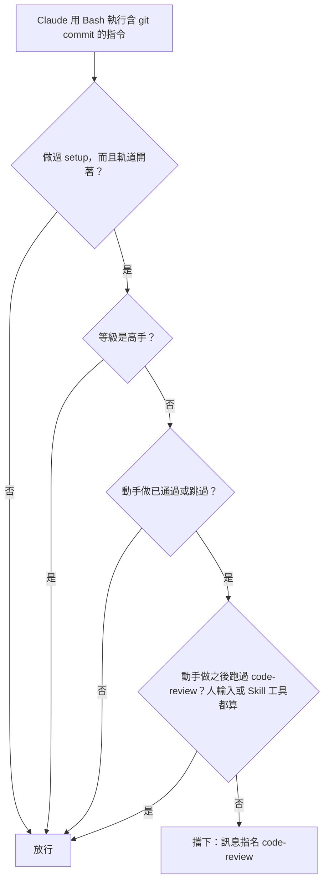

# 04: commit 關卡

**What to build:** 新手和進階等級，動手做期間還沒跑過 code-review 時，Claude 不能 commit。跑過一次 code-review 之後就放行，之後的修正不用再 review。高手等級完全不擋。

**Blocked by:** 02

**Status:** ready-for-agent

- [x] 新手、進階等級：動手做期間、code-review 還沒跑過時，執行 `git commit` 的 Bash 呼叫被擋下，訊息指名 code-review
- [x] code-review 跑過（不論是人輸入的，或是透過 Skill 工具執行的）之後放行；之後的修正不用再 review 就能 commit
- [x] 動手做以外的 commit 一律放行
- [x] 高手等級的 commit 永遠不擋
- [x] 不含 `git commit` 的 Bash 呼叫不受影響
- [x] 證據：完成時在本檔底下加「## 證據」，貼上新增測試先失敗、後通過的輸出，以及一張 mermaid 圖（一個 `git commit` 依等級和 code-review 狀態放行或擋下）

## 證據

新增的測試先跑（只列和這張卡相關的；其他既有測試全數通過）。「動手做以外、不 commit 的 Bash」和「高手」兩個測試描述的是放行，沒有關卡時本來就通過：

```
(fail) a beginner building cannot commit until code-review runs, then every later commit goes
  Expected: /code-review/
  Received: undefined
(fail) an intermediate building waits for code-review too, the person typing it counts
  Expected: /code-review/
  Received: undefined
(pass) commits outside building, and Bash that does not commit, always go
(pass) the expert commits freely: /implement-spec reviews its own work
(pass) an em-dash is denied inside the skills repo only
 20 pass
 2 fail
```

改完之後：

```
(pass) a beginner building cannot commit until code-review runs, then every later commit goes
(pass) commits outside building, and Bash that does not commit, always go
(pass) the expert commits freely: /implement-spec reviews its own work
(pass) an em-dash is denied inside the skills repo only
 22 pass
 0 fail
```

擋下訊息：

```
matt-flow：這次動手做還沒跑過 code-review，先不能 commit。先用 Skill 工具跑 code-review（或請人輸入 /code-review），跑過之後的 commit 都會放行。不要繞過這個阻擋。
```

一個 `git commit`（含 `git -C <dir> commit`）放行或擋下：



## Comments

- 2026-10-26（code-review 後）：「每次動手做只要求跑一次 code-review」解讀成每次人輸入 `/implement`（或 `/implement-spec`）都算一次動手做，所以進階等級一張卡一次 `/implement` 時，每張卡都要 review 一次。被擋下時 `/code-review` 會預填給人。
